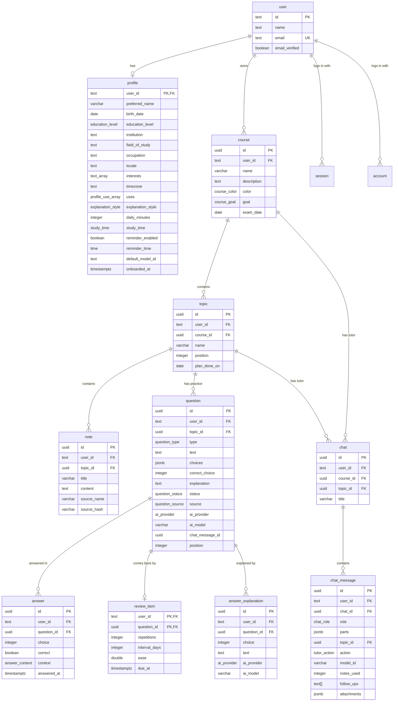

# Database

PostgreSQL with Drizzle ORM. The schema lives in [apps/server/src/db/schema](../apps/server/src/db/schema) and the SQL migrations in [apps/server/drizzle](../apps/server/drizzle). Designed in T-02 (#3).

## Tables



Every table also has `created_at` and `updated_at`.

| Table                                        | What it holds                                                                                                                                                                                                                                                                                                                                                                                                                                                                                                                                                                                                                                                                       |
| -------------------------------------------- | ----------------------------------------------------------------------------------------------------------------------------------------------------------------------------------------------------------------------------------------------------------------------------------------------------------------------------------------------------------------------------------------------------------------------------------------------------------------------------------------------------------------------------------------------------------------------------------------------------------------------------------------------------------------------------------- |
| `user`, `session`, `account`, `verification` | Login data, created and managed by Better Auth. Passwords are hashed in `account`, never in `user`.                                                                                                                                                                                                                                                                                                                                                                                                                                                                                                                                                                                 |
| `profile`                                    | One per user: the onboarding answers (what Orbi calls them, date of birth, how they use Orbi, level, field, interests, explanation style, daily minutes, study time, language, time zone). `onboarded_at` is set once every answer is there; until then the app sends the user to `/welcome`. `reminder_enabled` and `reminder_time` are the daily study reminder from the settings page, in the user's time zone. `default_model_id` is the catalog model new chats start on, also from the settings page. It is null until the student picks one, and a model the server can no longer call falls back to the server's default. `institution` and `occupation` are not asked yet. |
| `course`                                     | A course of a user: its colour, what it is for (`goal`), and an optional exam date.                                                                                                                                                                                                                                                                                                                                                                                                                                                                                                                                                                                                 |
| `topic`                                      | A topic inside a course. `position` keeps the order the user chose. `plan_done_on` is the student's own day they ticked it off in the exam study plan (US-12); the plan is worked out from it again each day, in the browser.                                                                                                                                                                                                                                                                                                                                                                                                                                                       |
| `note`                                       | Study notes pasted into a topic, or taken from an uploaded PDF (US-13). For a PDF, `source_name` is the file name and `source_hash` a SHA-256 of the file, so the same file uploaded to the topic again reuses its notes. The tutor reads them and makes questions from them.                                                                                                                                                                                                                                                                                                                                                                                                       |
| `chat`                                       | A tutor chat of one topic, or of the whole course when `topic_id` is null. It is named after its first message. The browser makes the id, so the first message needs no extra request.                                                                                                                                                                                                                                                                                                                                                                                                                                                                                              |
| `chat_message`                               | One message in a chat, in the AI SDK `UIMessage` shape: `parts` holds the text and the tool calls (for example the questions the tutor made). It also keeps the topic, the composer action, the model, how many notes the tutor read, the follow-up questions shown under an explanation, and the PDFs sent with a student's message (`attachments`: each file's name and the notes it was saved as). See [decision 0003](decisions/03-tutor-chat.md).                                                                                                                                                                                                                              |
| `question`                                   | A practice question. Only multiple choice for now: `choices` and the index of the `correct_choice`. AI questions start as `pending` until the student approves them (US-05), and keep the provider, the model, and the chat message that made them. `position` keeps the order the AI wrote a set in.                                                                                                                                                                                                                                                                                                                                                                               |
| `answer`                                     | Every answer the student gives to a question: the choice, whether it was right, and where (`chat` for the practice questions in the tutor chat, `session` for study sessions, US-06). It has `answered_at` instead of `created_at` and `updated_at`, since an answer never changes.                                                                                                                                                                                                                                                                                                                                                                                                 |
| `review_item`                                | When a question comes back for review (US-09). One row per question, with the SM-2 values: `repetitions` (right answers in a row), `interval_days`, `ease`, and `due_at`. The scheduler adds the row the first time the student answers the question and updates it after every answer, so a question with no row has not been scheduled yet. Answers in the chat and in study sessions both count. A right answer before the question is due keeps its schedule (see `packages/core/src/review-scheduler.ts`), so `updated_at` is when the schedule last changed.                                                                                                                  |
| `answer_explanation`                         | Why a wrong choice is wrong, written by the AI from the topic's notes when the student asks after a wrong answer in a study session (US-07). One row per question and choice, with the model that wrote it, so asking again reads it back instead of calling the AI.                                                                                                                                                                                                                                                                                                                                                                                                                |

## Rules the database enforces

- **Deleting cascades.** Deleting a user deletes their profile, courses, topics, and notes. Deleting a course deletes its topics, their notes and questions, and its chats. Deleting a topic deletes its notes, questions, and chats. Deleting a question deletes its answers and its review item. A chat message about a deleted topic stays, without the link.
- **Questions keep their chat message id without a foreign key.** A question is saved while its reply is still streaming, before the message exists, and deleting a chat should not delete the questions.
- **A question is well formed.** Its text is not blank, `correct_choice` points at one of its `choices`, and an AI question always has `ai_provider` and `ai_model`.
- **Ownership always matches.** `topic` and `note` keep a `user_id` so the server can check ownership with one simple `WHERE user_id = ...`. Their foreign keys include `user_id`, so a topic can only point at a course of the same user, and a note only at a topic of the same user. The server cannot get this wrong by mistake.
- **A question in the chat is answered once.** A unique index allows one `chat` answer per question, so two clicks at the same time still save only one. Study sessions can add as many `session` answers as they need.
- **A wrong choice is explained once.** A unique index on `(user_id, question_id, choice)` keeps one explanation per choice, so two clicks at the same time still save only one. It also backs the foreign key to `question`, so deleting a question deletes its explanations.
- **A review item is well formed.** There is at most one per question (the primary key is `(user_id, question_id)`), `repetitions` and `interval_days` are never negative, and `ease` never goes below 1.3, the SM-2 minimum.
- **One profile per user.** `profile.user_id` is the primary key.
- **No empty notes.** `note.content` must contain at least one character that is not a space or a line break. The server should still check this first and show a clear message (US-03).

## Why it differs from the drafts in #3

- **Ids are UUIDs** for our own tables instead of numbers. They cannot be guessed or counted from a URL, and the client or a future mobile app can create them before saving. Better Auth uses text ids, so every `user_id` is `text`.
- **No `course_name`, `topic_name`, `note_title`.** The table name already says it: `course.name`, `topic.name`, `note.title`.
- **`profile` has no separate `profile_id`.** `user_id` is the primary key, which also makes it unique.
- **`interests` is a list** (`text[]`), not one text field, so the app can show and filter them one by one.
- **`timezone` is text** with an IANA name like `Europe/Istanbul`, not a `time` value.
- **`content_hash` is left out for now.** It belongs to the AI question cache and is added with that task.
- **`review_item`, not `review_items`** as T-13 (#121) wrote it: every other table name is singular. It has no `id` of its own. A question has one review item, so `(user_id, question_id)` is the key.
- **Indexes:** `course(user_id, id)`, `topic(course_id, position)`, `topic(user_id, id)`, `note(topic_id, created_at desc)`, `note(user_id)`, and `question(user_id, status, created_at)`. The two `(user_id, id)` indexes also back the ownership foreign keys. A list's index has the columns it filters and sorts on, so the notes list and the review inbox read only the rows they show. Postgres does not index the other side of a foreign key by itself, so every foreign key that deletes or unlinks rows has an index on its columns, for example `chat(user_id, topic_id)`, `chat_message(topic_id)`, and `answer(user_id, question_id, answered_at)`. Without one, deleting a topic or a question reads the whole table. `review_item(user_id, due_at)` finds what is due today, and its primary key backs its foreign key.

## The mastery score is worked out, not saved

T-13 (#121) asked to either save the mastery score of each topic or work it out from the saved answers. Orbi works it out from `answer`, in `packages/core` (US-08):

- **A saved score goes out of date by itself.** Recent answers count more than old ones, so the score changes with the date even when the student does nothing. A saved score would need a job to keep it fresh.
- **There is one place to write.** Answering a question adds an `answer` row and updates the `review_item`. A saved score would be a third write that can drift from the other two.
- **Reading it is cheap.** A topic's answers come in time order through `answer(user_id, question_id, answered_at)`, joined to `question` for the topic. A student has hundreds or a few thousand answers, not millions.

How it is worked out (`masteryScore` in `packages/core/src/mastery.ts`): the share of right answers, where an answer counts half as much after two weeks and a quarter after four. One wrong answer is added at the start, so a single right answer gives 50, not 100, and a topic the student stops studying slowly goes down. Answers to rejected questions do not count, since those questions were bad. A topic with no answers has no score ("not started"). `GET /api/courses/:courseId/mastery` gives the score of every topic in a course.

If it gets slow later, a cache table can be added then, filled from the same function.

## Changing the schema

1. Edit the files in `apps/server/src/db/schema` (`app.ts` for our tables).
2. Create a migration and commit it together with the schema change:

   ```bash
   pnpm --filter server db:generate --name short-description
   ```

3. Start the server. It applies new migrations by itself before it takes requests, locally and on the VPS.

Never edit a migration that is already on `main`. Make a new one instead.

**Login tables:** do not edit `schema/auth.ts` by hand. After changing the Better Auth config in `apps/server/src/auth.ts` (for example adding a plugin), regenerate it from the repository root (it reads your `.env` there), run `pnpm format`, and then create a migration:

```bash
pnpm dlx auth@1.7.12 generate --config apps/server/auth.config.ts --output apps/server/src/db/schema/auth.ts --yes
```

Better Auth's own tables use `timestamp` without a time zone. That is fine: Drizzle always reads and writes them as UTC.

To look at the data, run `pnpm --filter server db:studio`.
