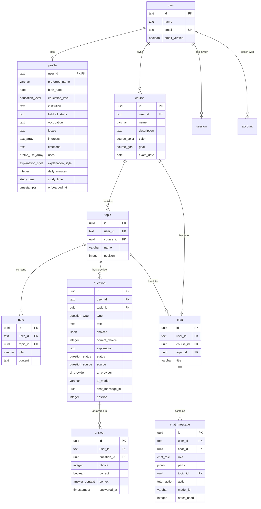

# Database

PostgreSQL with Drizzle ORM. The schema lives in [apps/server/src/db/schema](../apps/server/src/db/schema) and the SQL migrations in [apps/server/drizzle](../apps/server/drizzle). Designed in T-02 (#3).

## Tables



Every table also has `created_at` and `updated_at`.

| Table                                        | What it holds                                                                                                                                                                                                                                                                                                                                   |
| -------------------------------------------- | ----------------------------------------------------------------------------------------------------------------------------------------------------------------------------------------------------------------------------------------------------------------------------------------------------------------------------------------------- |
| `user`, `session`, `account`, `verification` | Login data, created and managed by Better Auth. Passwords are hashed in `account`, never in `user`.                                                                                                                                                                                                                                             |
| `profile`                                    | One per user: the onboarding answers (what Orbi calls them, date of birth, how they use Orbi, level, field, interests, explanation style, daily minutes, study time, language, time zone). `onboarded_at` is set once every answer is there; until then the app sends the user to `/welcome`. `institution` and `occupation` are not asked yet. |
| `course`                                     | A course of a user: its colour, what it is for (`goal`), and an optional exam date.                                                                                                                                                                                                                                                             |
| `topic`                                      | A topic inside a course. `position` keeps the order the user chose.                                                                                                                                                                                                                                                                             |
| `note`                                       | Study notes pasted into a topic. The tutor reads them and makes questions from them.                                                                                                                                                                                                                                                            |
| `chat`                                       | A tutor chat of one topic, or of the whole course when `topic_id` is null. It is named after its first message. The browser makes the id, so the first message needs no extra request.                                                                                                                                                          |
| `chat_message`                               | One message in a chat, in the AI SDK `UIMessage` shape: `parts` holds the text and the tool calls (for example the questions the tutor made). It also keeps the topic, the composer action, the model, and how many notes the tutor read. See [decision 0003](decisions/03-tutor-chat.md).                                                      |
| `question`                                   | A practice question. Only multiple choice for now: `choices` and the index of the `correct_choice`. AI questions start as `pending` until the student approves them (US-05), and keep the provider, the model, and the chat message that made them. `position` keeps the order the AI wrote a set in.                                           |
| `answer`                                     | Every answer the student gives to a question: the choice, whether it was right, and where (`chat` for the practice questions in the tutor chat, `session` for study sessions, US-06). It has `answered_at` instead of `created_at` and `updated_at`, since an answer never changes.                                                             |

## Rules the database enforces

- **Deleting cascades.** Deleting a user deletes their profile, courses, topics, and notes. Deleting a course deletes its topics, their notes and questions, and its chats. Deleting a topic deletes its notes, questions, and chats. Deleting a question deletes its answers. A chat message about a deleted topic stays, without the link.
- **Questions keep their chat message id without a foreign key.** A question is saved while its reply is still streaming, before the message exists, and deleting a chat should not delete the questions.
- **A question is well formed.** Its text is not blank, `correct_choice` points at one of its `choices`, and an AI question always has `ai_provider` and `ai_model`.
- **Ownership always matches.** `topic` and `note` keep a `user_id` so the server can check ownership with one simple `WHERE user_id = ...`. Their foreign keys include `user_id`, so a topic can only point at a course of the same user, and a note only at a topic of the same user. The server cannot get this wrong by mistake.
- **A question in the chat is answered once.** A unique index allows one `chat` answer per question, so two clicks at the same time still save only one. Study sessions can add as many `session` answers as they need.
- **One profile per user.** `profile.user_id` is the primary key.
- **No empty notes.** `note.content` must contain at least one character that is not a space or a line break. The server should still check this first and show a clear message (US-03).

## Why it differs from the drafts in #3

- **Ids are UUIDs** for our own tables instead of numbers. They cannot be guessed or counted from a URL, and the client or a future mobile app can create them before saving. Better Auth uses text ids, so every `user_id` is `text`.
- **No `course_name`, `topic_name`, `note_title`.** The table name already says it: `course.name`, `topic.name`, `note.title`.
- **`profile` has no separate `profile_id`.** `user_id` is the primary key, which also makes it unique.
- **`interests` is a list** (`text[]`), not one text field, so the app can show and filter them one by one.
- **`timezone` is text** with an IANA name like `Europe/Istanbul`, not a `time` value.
- **`content_hash` is left out for now.** It belongs to the AI question cache and is added with that task, together with `review_items` and its `(user_id, due_at)` index in Sprint 3.
- **Indexes:** `course(user_id, id)`, `topic(course_id, position)`, `topic(user_id, id)`, `note(topic_id)`, and `note(user_id)`. The two `(user_id, id)` indexes also back the ownership foreign keys.

## Changing the schema

1. Edit the files in `apps/server/src/db/schema` (`app.ts` for our tables).
2. Create a migration and commit it together with the schema change:

   ```bash
   pnpm --filter server db:generate --name short-description
   ```

3. Start the server. It applies new migrations by itself before it takes requests, locally and on the VPS.

Never edit a migration that is already on `main`. Make a new one instead.

**Login tables:** do not edit `schema/auth.ts` by hand. After changing the Better Auth config in `apps/server/src/auth.ts` (for example adding a plugin), regenerate it from the repository root (it reads your `.env` there), run `pnpm format`, and then create a migration:

```bash
pnpm dlx auth@1.7.12 generate --config apps/server/auth.config.ts --output apps/server/src/db/schema/auth.ts --yes
```

Better Auth's own tables use `timestamp` without a time zone. That is fine: Drizzle always reads and writes them as UTC.

To look at the data, run `pnpm --filter server db:studio`.
